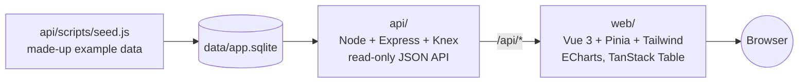

# RJHI dashboard template

The starting point for RJ Health Informatics dashboards: a Vue 3 + Tailwind front end and a Node + Express + Knex
API, with the RJHI layout and look built in. It includes:

- a full-height collapsible sidebar, the pill navbar and the brand
- the spotlight dot-grid background
- value boxes with sparklines, linked charts, and a sortable table with an Excel download

It runs straight away on made-up example data, so you can see every building block working before you change
anything.

## How it fits together



| Folder | What it is | On Azure |
|---|---|---|
| [`api/`](api/README.md) | Filtered, validated, paginated reads (`/api/summary`, `/api/organisations`, `/api/categories`) | Container App |
| [`web/`](web/README.md) | The dashboard (a single-page app) | Static Web Apps, with `/api` linked to the API |
| `scripts/` | One-command setup, and `npm run share` for a temporary public link | — |

## Quick start

**You need:** [Node.js](https://nodejs.org) 24 (or 22.18+). Nothing else.

```bash
npm run setup   # installs everything and builds the example data (about a minute)
npm run dev     # starts the API and the web app together
```

Then open **http://localhost:5173** and pick an organisation (or go straight to
http://localhost:5173/overview?org=A01).

| Command | Does |
|---|---|
| `npm test` | Runs the API and web test suites |
| `npm run seed` | Rebuilds the example data |
| `npm run share` | Shares the app at a temporary public link (see below) |

With Docker instead: `docker compose run --rm seed` once, then `docker compose up --build` and open
http://localhost:8080. CI builds both images on every push, but the full `docker compose` run hasn't been tested
end to end yet.

## Starting a new app from this template

1. On GitHub, click **Use this template** → **Create a new repository** (keep it **private**), then clone it.
2. Run `npm run setup` and `npm run dev`, and check the example dashboard works.
3. Rename it:
   - the `name` in the three `package.json` files
   - the `<title>` in `web/index.html`
   - the sidebar title and subtitle on each page
4. Set your sections and sub-pages in `web/src/sections.ts`. Each one needs a page file in `web/src/pages/`.
5. Replace the example data. Swap `api/scripts/seed.js` for your real import, or point `api/src/db.js` at a
   database, and adjust the routes in `api/src/routes/`.
6. Rename the filters to suit, in three places that must match: `web/src/stores/filters.ts`,
   `web/src/composables/useFiltersInUrl.ts`, and each API route's allow-list.
7. Use `web/src/pages/overview.vue` as the pattern for your main page: it has every building block in it.
8. Update this README and `CLAUDE.md` for the new app.

## Look and feel

- **Colours:** all colours are tokens in `web/src/assets/main.css`, with light and dark mode. Charts read the same
  tokens.
- **Palette:** the default is darkened from MBI's palette so that it passes contrast checks.
- **Blue palette:** the earlier RJHI blue is kept in the same file. Switch it on by adding
  `data-palette="rjhi-blue"` to the `<html>` tag in `web/index.html`.
- **Font:** Figtree, bundled with the app, so networks that block Google Fonts still get it.

## Sharing a temporary link

`npm run share` builds the app and serves it at a public `https://….trycloudflare.com` address, using a free
Cloudflare quick tunnel. Ctrl+C stops sharing. It needs Cloudflare's `cloudflared` program
(`winget install Cloudflare.cloudflared` on Windows).

**Public or made-up data only.** Anyone with the link can see the app: there's no sign-in, and traffic passes
through Cloudflare. Patient-level or other sensitive data needs proper hosting inside an approved environment, with
sign-in.

## Status

A template for local development. It has no sign-in or permissions, and the database is a local SQLite file.
Production hosting, authentication and data access are decided per app.

## Copyright

© 2026 RJ Health Informatics Ltd. All rights reserved. See [COPYRIGHT](COPYRIGHT). Access to this repository
(for example, for review or discussion) does not grant any right to copy or use it.
